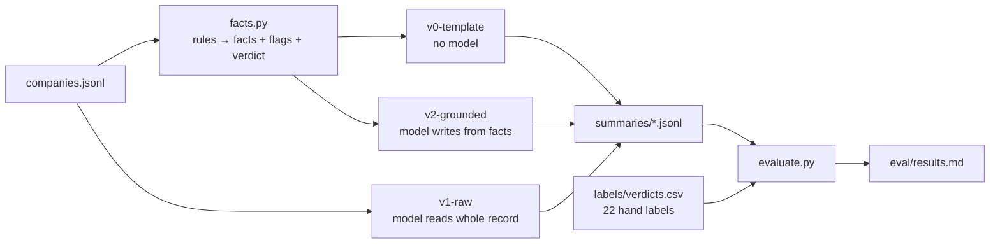
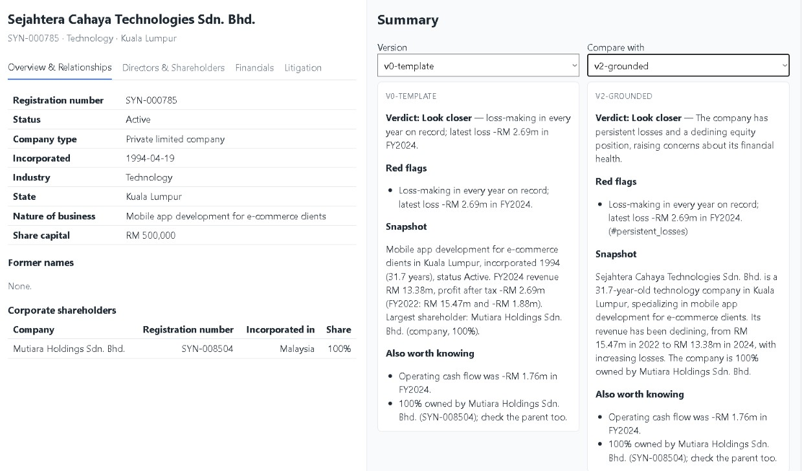
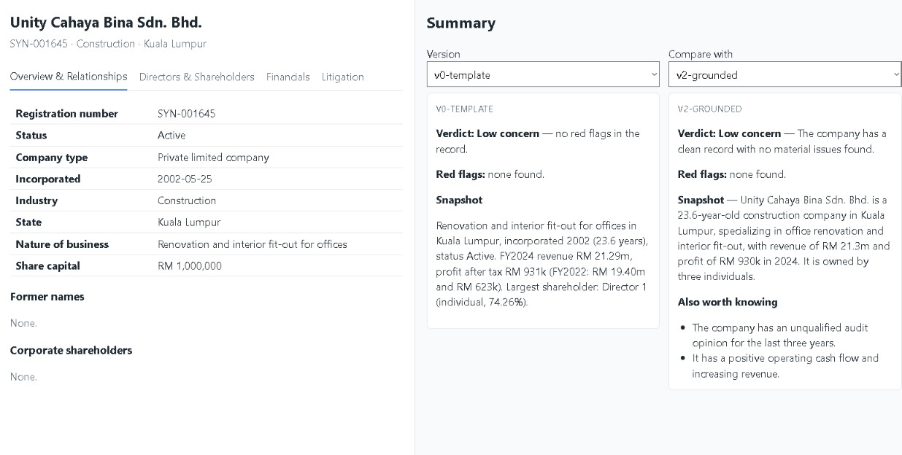

# Case study: company summaries for supplier vetting


## 1. What a good summary is for this team, and why

The team reads the summary to make one decision: is this company worth a closer look? So a summary is good if a
reader makes the same call from it that they'd make from the full record, faster. That gives an order of priorities:

1. **Don't miss a red flag.** Moving ahead with a company that's being wound up, or whose auditor couldn't sign off
   its accounts, is far more expensive than spending ten extra minutes on a clean one. Recall of serious issues comes
   first.
2. **Don't invent one, and don't misstate a number.** A summary nobody can trust gets skipped, and then it's worth
   nothing. Every number must trace back to the record.
3. **Say the verdict first.** The reader is triaging, so the first line is a call (`High concern` / `Look closer` /
   `Low concern`) with one reason. Details come after.
4. **Be short when there's nothing to say.** A clean company should take ten seconds. Length should scale with the
   number of problems, not with the size of the record.

What counts as a red flag came from reading records, not from a list I already had. The data has few of them and
they're specific: 2 of 50 companies are winding up; 3 of 127 audit opinions aren't clean; 32 companies have no court
cases at all, while a handful have 5 to 8. Ratios that look alarming in isolation (interest cover below 1 appears in
33 company-years) are mostly just a restatement of "made a loss", so I don't treat them as separate flags.

The format (in `summariser/render.py`, shared by every version):

```
**Verdict: Look closer** — revenue fell 38.8% over two years.
**Red flags**        one bullet each, most serious first, with the number behind it ("none found" if none)
**Snapshot**         2–3 sentences: what, where, how old; revenue and profit direction; who owns it
**Also worth knowing**  up to 3 minor points (corporate parent, new directors, recent rename)
```

## 2. What you built



**`summariser/facts.py`: rules first.** Deterministic code pulls out a trimmed set of facts per company and raises
flags with a severity: *critical* (not Active, winding-up petition against it, non-clean audit opinion, negative
equity), *warning* (losses, revenue or profit down by a fifth/half, material open litigation, missing or no accounts,
repeated winding-up petitions, a large settled claim, possible change of control), and *info*. The verdict is the worst
severity. Each flag carries its numbers in a plain sentence, so a summary can quote it and the evaluator can check it.

Four of the rules were added after I labelled a dev sample and saw what the first version missed:

| Company | What the rules missed | Rule added |
|---|---|---|
| SYN-000029 | Two directors who joined in Nov 2025 hold 79.5% of the shares | `control_change` |
| SYN-000923 | Revenue down 39% (profit-decline rule fired, but the cause wasn't stated) | `revenue_decline` |
| SYN-001389 | Three winding-up petitions since 2023, only one pending | `repeated_winding_up` |
| SYN-000397 | Settled a RM 7.43m claim with RM 2.37m of equity; terms unknown | `large_settled_claim` |

The `control_change` rule then fired on three companies I hadn't looked at (SYN-000510, -000545, -001560), which
was a useful check that it generalises rather than fitting one case. One rule I wrote turned out to be useless: a
link between companies with the same corporate parent. Several parents share a name ("Gemilang Holdings"), but they
always have different registration numbers, so there are no shared parents in this data. I match on registration
number, not name, and kept the check because it costs nothing.

I also caught a bug in my first pass: matching "Qualified" in audit opinions also matched "Unqualified", which
flagged every company that had accounts (47 of 50) as High concern. A reminder to look at the distribution of every rule's output, not just
whether it runs.

**Three versions:**

- **`v0-template`**: renders the facts with a template. No model. It's the baseline, and it's also a test of the
  evaluator: it can only state numbers from the facts, so it must score 100% on faithfulness (it does).
- **`v1-raw`**: the whole record goes to the model with the format spec. The obvious first attempt; it tests
  whether the model can find the red flags itself.
- **`v2-grounded`**: the model gets the facts and flags, must include every critical/warning flag, and may move the
  rule verdict one level if the figures clearly justify it (saying why). The model does the writing and some
  judgement; the code does the finding and the arithmetic.

**Model:** Llama 3.3 70B (`@cf/meta/llama-3.3-70b-instruct-fp8-fast`) on Cloudflare Workers AI's free tier,
temperature 0.2. Both model versions on 22 companies used roughly 4,000 of the 10,000 free daily "neurons". The client (`summariser/llm.py`) works with any
OpenAI-compatible API, waits between calls to stay under free-tier rate limits, retries on 429, and saves every
request and response to `runs/<version>/` so versions can be re-scored without calling the model again.

**Sample:** to save free-tier quota, the model versions run on the 22 hand-labelled companies (`--labelled`), and
`v0-template` runs on all 50. Every number below is one run of one model on a small sample (22 companies, 25
critical/warning flags), so a single company moves a percentage by several points.

## 3. How you know whether it's good

Each priority from section 1 has a metric, computed by `summariser/evaluate.py` without a model:

| Priority | Metric | How |
|---|---|---|
| Don't miss a red flag | **Flag recall**: share of critical/warning flags the summary mentions | a regex per flag type, deliberately loose |
| | **Missed High**: labelled High concern, but the verdict says otherwise | verdict line vs hand label |
| Don't invent one | **False alarms**: summary raises winding-up / bad audit / negative equity with no basis | regex, skipping negated sentences ("no winding-up petitions") |
| Don't misstate numbers | **Faithfulness**: share of RM amounts, %s and multiples that match the record | every number parsed, matched to the record within its displayed precision |
| Verdict first | **Verdict accuracy** vs hand labels, dev and held-out separately; missing verdict line counted | |
| Be short | median words, count over 160 | |

**Hand labels (`labels/verdicts.csv`).** 22 companies, each with a verdict and a one-line reason written from the
raw record. 12 are a *dev* set, picked to cover every kind of case (winding-up petitions, disclaimer, heavy litigation, missing
accounts, no accounts, young loss-makers, turnarounds, clean companies); I used these to improve the rules. 10 are a
*held-out* set, drawn at random (seed 2026) from the other 38 after the rules were frozen. Held-out accuracy is the
honest number. A limitation: I had seen the rules' output for some held-out companies before labelling them, so the
labels aren't fully blind.

**Testing the evaluator.** A metric is only useful if it catches what it claims to. `tests/test_evaluate.py` feeds it
hand-written summaries in the kind of wording a model uses: a correct one (must score full marks), one that drops two
flags and invents two numbers (must catch exactly those), one that claims a disclaimer for a clean company (false
alarm caught, while "there are no winding-up petitions" is not counted), and one with no verdict line.
`tests/test_llm.py` checks the client against a fake API: retry on 429, cache hit, cache miss when the prompt changes.

**Results** (from `eval/results.md`):

| Version | n | Flag recall | Missed High | False alarms | Faithful numbers | Verdict (dev) | Verdict (held-out) | Median words |
|---|---|---|---|---|---|---|---|---|
| rules only | 50 | – | 1/5 | – | – | 12/12 | 9/10 | – |
| v0-template | 50 | 100% (54/54) | 1/5 | 0 | 100% (363/363) | 12/12 | 9/10 | 68 |
| v1-raw | 22 | 64% (16/25) | 2/5 | 1 | 97% (108/111) | 5/12 | 8/10 | 99 |
| v2-grounded | 22 | 100% (25/25) | 1/5 | 0 | 100% (106/106) | 12/12 | 9/10 | 86 |

What the v0 numbers mean: 100% recall and faithfulness are true by construction, so they validate the plumbing
rather than the summaries. Dev 12/12 is expected because the rules were tuned on it. The useful number is held-out
9/10, and the miss is informative: **SYN-000785** has made a loss every year, which has cut equity from RM 5.3m to RM
0.4m. One more year like that and equity goes negative. I labelled it High concern; the rules say Look closer because
equity is still technically positive. This is the kind of judgement I hoped a model would add in `v2-grounded`, and
it's why v2 may move the verdict one level. It didn't (see below).

What v0 gets wrong, which the metrics don't show: it reads like a machine wrote it. It repeats itself (a petition
bullet followed by a "2 winding-up petitions" bullet), and its verdict reason is "...plus 5 more". That's the main
case for a model writing the prose.

**v1-raw: giving the model the whole record isn't safe.** It mentioned 16 of 25 serious flags. What it missed is
telling: missing financial years (2 of 2), repeated winding-up petitions (2 of 2), the only change of control, the only case of no financials
and the only large settled claim. None of these is a value sitting in a field. A missing FY2023 is a gap between
two years; repeated petitions mean counting across cases; a change of control means joining directors' appointment
dates to the shareholder list. The model reads values well and notices absences and cross-references badly, which is
exactly the work the rules do. Its verdicts were also miscalibrated in both directions: it called four clean companies
"Look closer" (SYN-000546, -001529, -001829, -001894) while under-rating two high-concern ones (SYN-000217's
disclaimer, SYN-001389's repeated petitions), so it matched only 5 of 12 dev labels.

**SYN-000785 shows why a correct verdict isn't enough.** v1 called it High concern, matching my label, but for a
wrong reason: it said the company has *negative equity*, when equity is RM 397k, positive but almost gone. It also
said the company has "RM 13.38m cash"; cash is RM 1.33m and RM 13.38m is revenue. Scoring verdicts alone would have
counted this as a success.

**That example also exposed a blind spot in my faithfulness check.** It confirms that a number appears somewhere in
the record, not that it's attached to the right thing, so "RM 13.38m cash" passed. The false-alarm check did catch
the invented negative equity. The 3 numbers that failed faithfulness were partly derived rather than invented: "49%"
for SYN-000381 is the two directors' combined stake (24.89% + 24.11%), which is correct but not in the record.
Lesson: an "unsupported" number needs reading, and a "supported" one isn't necessarily right.

**v2-grounded: the model writes well when code does the finding.** Every flag was mentioned, with no false alarms
and no unsupported numbers, and summaries got shorter than v1's (median 86 vs 99 words) despite covering more.

**But the judgement step added nothing.** v2's verdict accuracy is identical to the rules alone, and on SYN-000785 it
kept "Look closer" even though RM 397k of equity against a RM 2.69m annual loss means equity turns negative next year
at the current rate. The equity figures were in its input; it said "declining equity position" without the numbers
and didn't act on it. With permission to override, Llama 3.3 70B deferred to the rules. Either a stronger model would
behave differently, or the instruction needs to point at specific patterns; I haven't tested which. The fix I'd make
is a rule ("latest loss larger than remaining equity → critical"), not a prompt change, since this is arithmetic. But
SYN-000785 is in my held-out set, so adding that rule now would mean the held-out score no longer measures anything.
I've left it as a next step.

**On these metrics, v2 and the no-model template score the same.** The difference is the writing, which none of my
metrics measure. Reading them side by side, v2 explains instead of listing. It has presentation bugs too: it sometimes
leaks internal flag IDs into the text, e.g. "(#persistent_losses)", and repeats the parent company in two sections.
Both versions write "loss -RM 2.69m", a double negative that comes from my own flag text in `facts.py`, not from the
model.

v0 (left) against v2 (right) on a risky company and a clean one:





## 4. What you'd do next, and how you'd keep improving it

1. **Get the labels from the team, not from me.** My 22 labels are one non-expert's judgement. The highest-value next
   step is to have two people on the vetting team label the same 30 companies, measure how often they agree with each
   other, and treat that agreement as the ceiling. If they disagree on whether a 26%-of-equity open claim matters,
   that's a threshold to agree on, not a model problem.
2. **Measure the decision, not just the text.** The real test is whether a reader using the summary makes the same
   go / look-closer call as one reading the full record, and how much time it saves. A small A/B with the team would
   answer that directly.
3. **Make the thresholds explicit and owned.** "Revenue down 20%" and "claims over 25% of equity" are my guesses. They
   should live in a config the team can change, with the evaluation re-run on every change.
4. **Grow the test set with every miss.** Each time a reader says "the summary didn't mention X", add that company
   and its label to the set, and add a rule or prompt change only if the eval improves on held-out data.
5. **Make the faithfulness check field-aware:** match "cash RM x" against the cash field, not anywhere in the record.
   That would have caught v1's revenue-as-cash error.
6. **Fix v2's presentation bugs** (flag IDs in text, double negatives) and add a format check for them, then add the
   equity-runway rule once there's a fresh held-out set to measure it on.
7. **Add an LLM judge only where regexes can't reach,** such as whether the verdict sentence's reason is actually the
   most important one. I'd calibrate it against the hand labels before trusting it.
8. **Monitor in production:** rate of summaries with unsupported numbers, missing verdict lines, and how often readers
   open the full record for Low-concern companies (a sign the summary isn't trusted).

What's left undone: the model versions ran on 22 companies, not all 50, and only once each; and
the evaluator's regexes are tuned on my own test sentences, so they will miss some phrasings. That's why every
mismatch is written to `eval/details/` to read by eye.

## How to run it

```bash
just setup
just test                              # evaluator + LLM client tests, no key needed
just generate v0-template              # baseline, all 50
cp .env.example .env                   # then fill in a free-tier key
just generate v1-raw --labelled        # 22 companies
just generate v2-grounded --labelled
just eval                              # writes eval/results.md
just up                                # viewer at localhost:8000, compare versions side by side
```

On Windows without bash, run the same steps with `uv run python -m summariser ...` (`generate`, `eval`) and
`uv run pytest -q`.

## Tools used

The code and a first draft of this write-up were produced with Claude (Anthropic) working from my direction in a
chat session. The summaries themselves were generated by Llama 3.3 70B on Cloudflare Workers AI. I chose the model provider, ran the experiments on my machine, and reviewed every label against the raw records.
